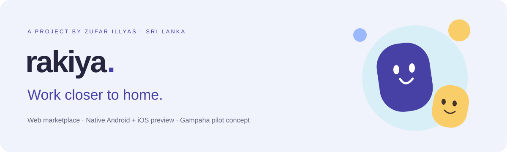
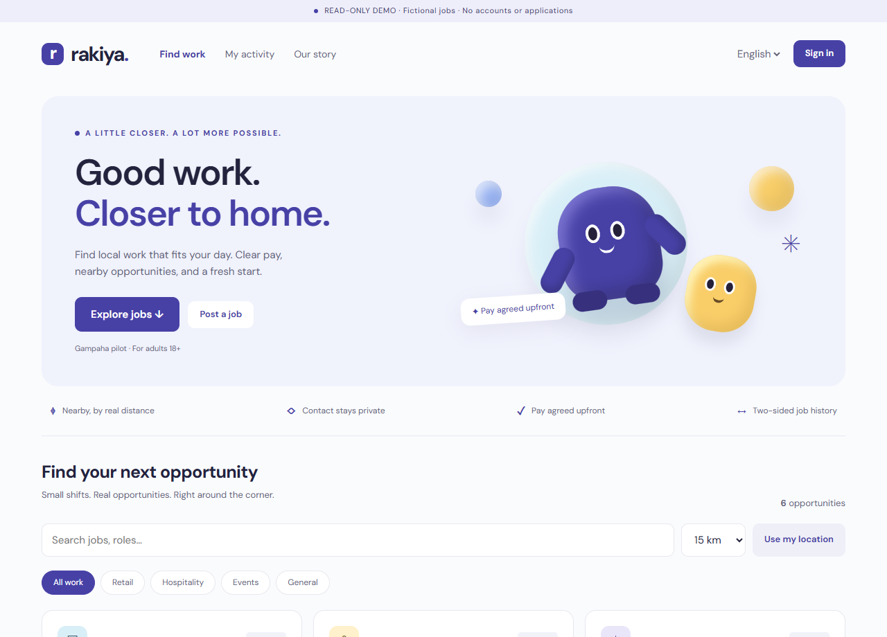

<p align="center"></p>

<p align="center"><strong>A local-first marketplace for short-term work in Sri Lanka.</strong><br>Created by <a href="https://github.com/zufar17ig">Zufar Illyas</a> · Gampaha pilot concept · Adults 18+</p>

<p align="center"><a href="https://zufar17ig.github.io/rakiya-demo/"><strong>Project showcase</strong></a> &nbsp;·&nbsp; <a href="https://zufar17ig.github.io/rakiya-demo/demo/"><strong>Interactive website demo</strong></a> &nbsp;·&nbsp; <a href="mobile/"><strong>Native app source</strong></a> &nbsp;·&nbsp; <a href="docs/DEVELOPMENT.md"><strong>Developer guide</strong></a></p>

## The idea

Local shops and event organisers need short-notice help. Students and casual workers want flexible opportunities close to home. Rakiya brings both sides into one clear journey—from discovering a nearby job to confirming what happened after the shift.

## See the website

[](https://zufar17ig.github.io/rakiya-demo/demo/)

**[Try the interactive demo →](https://zufar17ig.github.io/rakiya-demo/demo/)**

The public demo is read-only and uses fictional jobs. You can browse, search and filter the interface without an account. Full account and hiring workflows run in the local development app; no real vacancy, payment or customer adoption is implied.

## What has been built

| Experience | Implemented in the local app |
| --- | --- |
| Worker accounts | Adult registration, profiles, skills and job applications |
| Employer accounts | Job posting, applicant review, acceptance, decline and hold |
| Nearby discovery | Category/search filters and straight-line distance ranking |
| Contact privacy | Contact details revealed only to accepted matches |
| Job history | Employer work confirmation, worker compensation confirmation and ratings |
| Support tools | Cancellation, withdrawal, private disputes and staff review |
| Language | English/Tamil interface dictionaries; Sinhala-ready structure |
| Platforms | Responsive website and shared native Android/iOS source |

## Native mobile app

The `mobile/` directory contains a **React Native / Expo** app with native controls, encrypted session storage, opt-in foreground location and the same marketplace backend.

**[Browse app source](mobile/) · [Test on a phone](mobile/README.md)**

Android and iOS code bundles have been validated. A physical Samsung A56/iPhone test and standalone APK/IPA releases are still pending. The phone image on the showcase is explicitly the mobile web interface, not a native-device screenshot.

## A complete hiring loop

**Post → Discover → Apply → Accept → Work → Confirm compensation → Build history**

The two-sided completion record captures what the parties report. It is not independent proof of payment or identity verification.

## Engineering & verification

**Backend:** Python, Django 5.2, SQLite<br>
**Web:** JavaScript, responsive CSS, original procedural character artwork<br>
**Mobile:** TypeScript, React Native, Expo, Expo Router<br>
**Checks:** Django tests, browser journey checks, TypeScript, ESLint, Android/iOS bundle builds and GitHub Actions

29 backend tests passed locally. The browser hiring journey was exercised at desktop and phone widths. Native bundles build for both platforms. [See automated checks](https://github.com/zufar17ig/rakiya-demo/actions) and the [detailed build status](docs/BUILD_STATUS.md).

## Run locally

```powershell
python -m venv .venv
.\.venv\Scripts\python.exe -m pip install -r requirements-lock.txt
.\.venv\Scripts\python.exe manage.py migrate
.\.venv\Scripts\python.exe manage.py seed_examples
.\.venv\Scripts\python.exe manage.py runserver 127.0.0.1:8000
```

Open `http://127.0.0.1:8000`. After setup, Windows users can double-click **Start Rakiya.cmd**. Use test data only. [Complete setup, admin and security notes →](docs/DEVELOPMENT.md)

## Current stage & next steps

This is a **development prototype**, not a launched employment service. Phone numbers and age declarations are not independently verified. SMS, WhatsApp automation and payment processing are not connected. Native dependency security findings, account recovery, production hosting, physical-device verification and real pilot validation remain release work. [Read the current limitations](docs/BUILD_STATUS.md).

## Creator & acknowledgements

**Zufar Illyas — Founder & Product Lead**<br>
Accounting Information Systems student, University of Kelaniya, Sri Lanka.

Developed with AI-assisted implementation and testing. Report/presentation assistance is acknowledged to Fathima Hilmy, Ashini Wageesha, Chandhupa Chamupathi and Isuru Sathsara; exact contribution wording remains subject to confirmation. No ongoing cofounder or operational role is implied.

## License

An open-source license for Rakiya has **not yet been selected**. Public availability does not grant a general reuse license. The [Expo starter notice](mobile/EXPO_TEMPLATE_LICENSE.txt) applies to third-party starter material; dependencies retain their own licenses.
